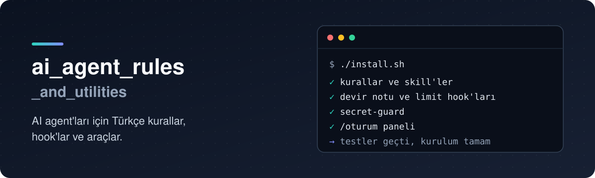

# AI Agent Rules and Utilities



Claude Code ve Codex ile çalışırken her oturumda geçerli olan kurallar, skill'ler, hook'lar ve araçlar.

> **English:** Rules, skills, hooks and tools for Claude Code (and Codex), written for Turkish speakers: the rules make the agent answer in Turkish. Some parts work for anyone: handoff notes when the context or the usage limit runs out, a secret guard that blocks commands which would print secrets, a `/oturum` pane that lists your sessions, and a subagent setup. Needs macOS or Linux with bash, python3, jq and iconv. Windows support is planned for a later release. Run `./install.sh --check` first: it shows what would change and changes nothing. `./install.sh` backs up and rewrites `~/.claude/CLAUDE.md`, adds hooks to `~/.claude/settings.json`, and installs skills, agents and mods. Tip: give this repo's URL to Claude Code or Codex and say "install this"; ask it to show the `--check` output first. This is a community project, not affiliated with Anthropic or OpenAI.

Repo Türkçe konuşan kullanıcılar için yazıldı. Kurallar ve Türkçe skill'ler Türkçedir. Bir terimin Türkçe mi İngilizce mi yazılacağına "Terimler" bölümündeki sistem karar verir.

## Bu repo ne işe yarar

Claude ile her gün çalışıyorsan bu sorunları tanırsın:

| Sorun | Bu repo ile |
|---|---|
| Claude her oturumda başka türlü yazıyor. | Hep aynı kurallar: Türkçe, kısa, önce sonuç. |
| Limit dolunca ya da konuşma uzayınca iş yarım kalıyor. | Claude devir notunu kendisi yazar. Yeni oturum kaldığı yerden devam eder. |
| Hangi oturum nerede, hatırlamıyorsun. | `/oturum`: bütün oturumlar tek panelde. Seç, devir notu yazdır, tek tıkla kopyala. |
| Bir komut şifreni ekrana basabilir. | Gizli bilgileri döken komutlar engellenir. |
| Basit bir iş için pahalı model çalışıyor. | Her iş ona uygun modele gider. |

Tek komutla kurulur. Bir makineye de kurabilirsin, istediğin kadar makineye de.

> İpucu: Bu repo'nun adresini Claude Code'a veya Codex'e ver ve "bunu kur" de. Agent repo'yu indirip kurulumu senin yerine yapabilir. Önce `./install.sh --check` çıktısını göstermesini iste: böylece neyin değişeceğini kurulumdan önce görürsün.

## Gereksinimler

- macOS veya Linux. Windows desteği daha sonra eklenecek.
- git, bash, python3, jq ve iconv.
- Claude Code. Modlar (`usage-feed` ve `/oturum`) için 2.1.308 veya daha yeni sürüm gerekir. Sürüm eskiyse kurulum yalnız modları atlar.
- `/oturum` paneli Claude Desktop'ta açılır. Terminalde `/oturum` komutu aynı listeyi metin olarak verir.
- Codex isteğe bağlıdır.
- Hook'lar ve panel saatleri Türkiye saatiyle (UTC+3) yazar.

## Makinende ne değişir

Önce `./install.sh --check` çalıştır. Bu komut neyin değişeceğini gösterir ve hiçbir şeyi değiştirmez.

`./install.sh` şunları yapar. Değiştirdiği her dosyayı önce yedekler.

- `~/.claude/CLAUDE.md` dosyasını yeniden yazar. İşaretli blokların dışındaki satırlar yeni dosyaya geçmez, yalnız yedekte kalır.
- `~/.claude/settings.json` dosyasına hook kayıtlarını ve iki `deny` kuralını ekler. Diğer ayarlarına dokunmaz.
- `secret-guard` hook'unu kurar. Hook, gizli dosyaları okuyan veya ortam değişkenlerini döken komutları engeller.
- Kullanım limiti hook'unu kurar. Limit %91 ve %96'yı geçince hook çalışan işi durdurur ve devir notu ister.
- Devir notları her projenin `.claude/` klasörüne yazılır. Oturum dökümleri `~/.claude/handoff-dumps/` altına yazılır.
- Skill'leri `~/.claude/skills/`, agent'ları `~/.claude/agents/`, modları `~/.claude/local-mods/` altına kurar.
- Terim profilini senin transcript'lerindeki mesajlarından üretir. Cache `~/.cache/ai_agent_rules/` altındadır.

Geri almak için aşağıdaki "Geri alma" bölümüne bak.

## İçerik

| Path | Ne işe yarar |
|---|---|
| `AGENTS.md` | Kural seti. Tek kaynak. |
| `terms/override.md` | Boş override şablonu. `install.sh` bunu `local/override.md` olarak kopyalar. Kendi kararların `local/override.md` dosyasındadır (git'te değil). |
| `terms/pairs.tsv` | Kavram çiftleri. Örnek: dosya / file. |
| `generated/term_profile.md` | Terim profili. Script üretir. Git'e girmez. |
| `scripts/term_profile.py` | Profili mesajlarından üretir. |
| `scripts/install_hook.py` | Profil hook'unu `~/.claude/settings.json` dosyasına ekler. |
| `hooks/` | Handoff, kullanım limiti ve secret-guard hook'ları, test'leriyle. |
| `local-mods/` | usage-feed ve oturum modları ve yerel marketplace'i. |
| `scripts/install_hooks.sh` | Hook'ları ve usage-feed modunu kurar. `--check` ile yalnız karşılaştırır. |
| `scripts/hooks_settings.py` | Hook kayıtlarını `~/.claude/settings.json` dosyasına yazar. |
| `agents/` | Subagent dosyaları: `reader`, `coder`, `reviewer`, `opus-worker`, `fable-worker`. |
| `rules/subagent-routing.md` | Subagent yönlendirme kuralları. `~/.claude/CLAUDE.md` bu dosyayı import eder. |
| `scripts/install_subagents.sh` | Subagent düzenini kurar. `--check` ile yalnız karşılaştırır. |
| `scripts/local_info.sh` | Eksik `local/ben.md` ve `local/reader-tools.txt` dosyaları için soru sorar. `--check` ile yalnız durumu gösterir. |
| `scripts/status.sh` | Kurulumun durumunu tek tabloda gösterir. `./install.sh --status` bu script'i çalıştırır. |
| `scripts/codex_rules.py` | Kuralları Codex için tek dosyaya yazar: `~/.codex/AGENTS.md`. |
| `scripts/verify.sh` | Test'leri kurulum yapmadan çalıştırır. CI da bunu çalıştırır. |
| `scripts/rule_check.py` | Yanıt biçimini örnek görevlerle denetler. Örnekler: `scripts/tests/rule_cases.json`. |
| `scripts/tests/` | `scripts/` altındaki Python script'lerinin test'leri. |
| `local.example/` | `local/` klasöründeki kişiye özel dosyaların örnekleri. |
| `scripts/subagents_settings.py` | Subagent ayarlarını `~/.claude/settings.json` dosyasına yazar. |
| `docs/` | Hook'ların, secret-guard'ın, usage-feed modunun ve subagent düzeninin tasarım belgeleri. |
| `skills/adhd-tr` | Yanıt biçimi. `i-have-adhd` skill'inin Türkçe uyarlaması. |
| `skills/humanizer-tr` | AI izlerinden kaçınma. `humanizer` skill'inin Türkçe uyarlaması. |
| `skills/sade-teknik-turkce` | Türkçe cümle yapısı ve netlik. |
| `skills/i-have-adhd` | İngilizce orijinal. |
| `skills/humanizer` | İngilizce orijinal. |
| `skills/asd-ste100` | İngilizce orijinal. |
| `UPSTREAM.md` | Kaynak repo'lar, commit'ler ve lisanslar. |
| `install.sh` | Claude Code kurulumu. `--check` ile yalnız karşılaştırır. |

## Claude Code kurulumu

1. Repo'yu clone et.
2. `./install.sh` çalıştır.
3. Yeni bir Claude Code oturumu aç.

`install.sh` şunları yapar:

- Eksik `local/ben.md` ve `local/reader-tools.txt` dosyaları için soru sorar. Her soru isteğe bağlıdır. Terminal yoksa soru sormaz. Ayrıntı: `local.example/README.md`.
- Mevcut `~/.claude/CLAUDE.md` dosyasını, `~/.claude/settings.json` dosyasını ve skill link'lerini `~/.claude/backups/` altına yedekler.
- `~/.claude/CLAUDE.md` dosyasını yeniden yazar. Yeni dosya, `AGENTS.md` dosyasını, `adhd-tr` skill'ini ve `rules/subagent-routing.md` dosyasını import eder.
- Eski `CLAUDE.md` dosyasındaki işaretli bloklar yeni dosyada kalır. Blok dışındaki satırlar yeni dosyaya geçmez. `install.sh` bu satırları bir uyarıyla listeler ve yedeğin yolunu yazar. Bir satırın kalmasını istiyorsan onu `<!-- <ad>:baslangic -->` ve `<!-- <ad>:bitis -->` satırlarının arasına koy.
- Bütün skill'leri `~/.claude/skills/` altına symlink olarak bağlar.
- `~/.agents/skills/` klasörü varsa `sade-teknik-turkce` skill'ini oraya da bağlar. Klasör yoksa bu adımı atlar ve klasörü açmaz.
- Terim profilini üretir.
- `~/.claude/settings.json` dosyasına bir SessionStart hook'u ekler. Diğer hook'lara dokunmaz.
- Handoff ve kullanım limiti hook'larını ve usage-feed modunu kurar. Ayrıntı aşağıdaki "Hook'lar ve usage-feed" bölümünde.
- Subagent düzenini kurar. Ayrıntı aşağıdaki "Subagent düzeni" bölümünde.

Repo'yu başka bir klasöre taşırsan `install.sh` script'ini yeniden çalıştır.

Kurulumu repo ile karşılaştırmak için `./install.sh --check` çalıştır. Bu mod hiçbir şeyi değiştirmez. Şunları kontrol eder:

- `~/.claude/CLAUDE.md` içindeki import satırları. `install.sh` dosyaya başka bir metin yazacaksa `--check` farkı gösterir.
- `~/.claude/skills/` altındaki skill link'leri. `~/.agents/skills/` varsa oradaki link'leri de kontrol eder. Klasör yoksa `skipped` yazar.
- Terim profilinin SessionStart hook'u. Repo taşındıysa eski kopyayı `outdated` olarak gösterir.
- Hook'lar, usage-feed modu, subagent düzeni ve terim profili cache'i.

Bir fark veya cache sorunu varsa çıkış kodu 1'dir. Eksik bir `local/` dosyası çıkış kodunu değiştirmez.

Durumu tek ekranda görmek için `./install.sh --status` çalıştır. Bu mod da hiçbir şeyi değiştirmez. Her bileşen tabloda tek satırdır: commit, `claude` sürümü, son kurulum saati, kurallar, hook'lar, subagent'lar, terim profili ve `local/` dosyaları. Komutu kurulumu yaptığın clone'da çalıştır. Başka bir clone'da kurallar ve hook farklı görünür.

`./install.sh --status --all` aynı tabloyu `local/machines.md` dosyasındaki makineler için de gösterir. Satır biçimi `local.example/machines.md` dosyasındadır.

- Script makinelere SSH ile bağlanır. Makineleri aynı anda kontrol eder.
- SSH parola veya onay isterse o makine için `ssh failed` yazar.
- Bir makinenin commit'i bu makineninkinden farklıysa o makine için `needs a look` yazar.
- Uzak repo'da `scripts/status.sh` yoksa `old repo` yazar. O makinede `git pull` çalıştır.

Bir makine `needs a look` ise o makinede `./install.sh --check` çalıştır. Çıkış kodu: bakılacak bir şey yoksa 0, varsa 1.

### Hook'lar ve usage-feed

- Kaynak bu repo'dur. Hook'lar `hooks/`, mod `local-mods/` klasöründedir. Tasarım belgeleri `docs/` altındadır.
- `install.sh` dosyaları `~/.claude/hooks` ve `~/.claude/local-mods` altına kopyalar. Symlink kullanmaz, çünkü açık oturumlar hook'ları sürekli çağırır.
- Bir dosya değiştiyse script önce test'leri staging klasöründe çalıştırır. Test'ler geçerse eski dosyayı `.bak-YYYYMMDD` olarak yedekler ve yenisini koyar.
- `~/.claude/hooks/usage-limit.conf` senin ayarındır. Dosya yoksa yazılır. Farklıysa script farkı gösterir ve dosyayı değiştirmez.
- usage-feed için Claude Code 2.1.308 veya daha yeni bir `claude` gerekir.
- Değişikliği repo'da yap. Test'ini aynı commit'e koy. `~/.claude/hooks` altındaki dosyaları elle değiştirme.
- Kurulu dosyaları repo ile karşılaştırmak için `./install.sh --check` çalıştır. Bu mod hiçbir şeyi değiştirmez. Terim profili cache'inin durumunu da gösterir.
- Kurulum ve `--check`, `secret-guard.py` için iki şeyi de gösterir: yerel kural dosyası (`~/.claude/hooks/secret-guard.local.json`) ve PATH'teki `claude` sürümü. Bozuk bir yerel kural veya 2.1.295'ten eski bir `claude` uyarı verir. Eski `claude`, hook çalışamadığında çağrıyı engellemez. Kurulum bu uyarıları düzeltmez.
- `secret-guard.py`, gizli dosyaların içeriğini ve ortam değişkenlerini transcript'ten uzak tutar. Engellediği bir çağrı için Claude sana bir komut verir. Komutu Claude dışındaki bir terminalde çalıştırırsan secret'ı orada görürsün. Ayrıntı: `docs/secret_guard.md`.

### Subagent düzeni

- Kaynak bu repo'dur. Agent dosyaları `agents/` klasöründedir. Yönlendirme kuralları `rules/subagent-routing.md` dosyasındadır. Tasarım belgesi `docs/subagent_setup.md` dosyasıdır.
- `install.sh` beş agent dosyasını `~/.claude/agents` altına kopyalar. Bu klasördeki diğer dosyalara dokunmaz.
- Kurulu bir agent dosyası repo'dakinden farklıysa script farkı gösterir. Sonra eski dosyayı `~/.claude/backup-subagent-<tarih>/agents/` altına yedekler ve yenisini koyar.
- Repo'daki `reader` dosyası yalnız temel araçları listeler: Read, Grep, Glob ve ToolSearch. Ek araçlar `local/reader-tools.txt` dosyasından gelir. Dosya yoksa `reader` yalnız temel araçlarla kurulur. Örnek: `local.example/reader-tools.txt`.
- Script, `~/.claude/settings.json` içindeki `permissions.deny` listesine `Agent(model:*opus*)` ve `Agent(model:*fable*)` kurallarını ekler. Listedeki diğer kurallara dokunmaz.
- Script, `env.CLAUDE_CODE_MAX_CONCURRENT_SUBAGENTS` anahtarı yoksa değeri `"2"` olarak yazar. Anahtar başka bir değerle varsa o senin ayarındır. Script uyarır ve değeri değiştirmez.
- Script, `settings.json` dosyasını değiştirmeden önce `~/.claude/backup-subagent-<tarih>/` altına yedekler.
- `~/.claude/CLAUDE.md` yönlendirme kurallarını import eder. Eski dosyada `subagent-duzeni` işaretli bloğu varsa `install.sh` bu bloğu yeni dosyaya almaz. Diğer işaretli bloklar kalır.
- `~/.claude/agents` bir symlink olmamalı. Symlink ise `install.sh` en başta durur.
- Değişikliği repo'da yap. `~/.claude/agents` altındaki dosyaları elle değiştirme.
- Kurulu düzeni repo ile karşılaştırmak için `./install.sh --check` çalıştır.

### Yeni bir makineye kurulum

Gerekenler:

- bash, python3, jq, iconv ve bu repo'ya erişim. Hook'ların tam araç listesi `docs/handoff_and_limit_hooks.md` içindeki "Ön koşullar" bölümündedir. `install.sh` bu araçları en başta kontrol eder ve eksik varsa hiçbir şeyi değiştirmeden durur.
- usage-feed modu için Claude Code 2.1.308 veya daha yeni bir `claude`. Bulunamazsa `install.sh` yalnız modu atlar.
- `~/.claude/settings.json` bir symlink olmamalı. Symlink ise `install.sh` en başta durur.

1. Repo'yu clone et.
2. İstersen terim profilini bu makineden taşı. Adımlar aşağıda.
3. `./install.sh` çalıştır.

Yeni makinede profil boş başlar, çünkü o makinede mesaj geçmişi yoktur. Profil boşken Claude terimler için ilkeyi uygular. Profili taşımanın iki yolu var:

- Önerilen yol: terim tercihlerini export ve import et. Adımlar "Terim tercihlerini başka makineye taşıma" bölümündedir. Taşınan dosyada mesaj metni yoktur.
- `install.sh` çalışmadan önce `~/.cache/ai_agent_rules/messages.json` dosyasını yeni makinede aynı yola kopyala. Bu dosya senin temizlenmiş mesajlarını içerir.

### Codex

Claude Code, `AGENTS.md` içindeki `@dosya` satırlarını izler. Codex bu satırları düz metin olarak okur. Bu yüzden `install.sh` Codex için tek bir dosya yazar: `~/.codex/AGENTS.md`.

- Dosyada `AGENTS.md` metni, import edilen dosyaların metni ve `adhd-tr` skill'i vardır. `rules/subagent-routing.md` Claude'a özeldir, dosyada yoktur.
- `install.sh` dosyayı yalnız `~/.codex` klasörü varsa yazar. `CODEX_HOME` ayarlıysa o klasörü kullanır.
- Boş bir dosyayı veya bu repo'nun yazdığı dosyayı değiştirir. Başka bir dosyayı değiştirmez, uyarı yazar.
- Terim profili değişince `scripts/term_profile.py` dosyayı yeniden yazar. `AGENTS.md` değişince `./install.sh` çalıştır. `./install.sh --check` eski dosyayı `outdated` olarak gösterir.
- Codex önce `~/.codex/AGENTS.override.md` dosyasını okur. O dosya boş değilse bu dosyayı okumaz. Kaynak: [Codex · AGENTS.md](https://learn.chatgpt.com/docs/agent-configuration/agents-md).
- Codex'te gerçek bir oturumla yükleme testi yapılmadı.

### SSH oturumları

Desktop'taki SSH oturumlarında Claude Code uzak makinede çalışır. Kuralların orada da geçerli olması için repo'yu uzak makineye de kur. Uzak makinedeki kullanıcı hesabını başkaları da kullanıyorsa kurma. Kurulum o hesabın bütün Claude Code oturumlarını değiştirir.

## Terimler

Claude bir terimin dilini şu sırayla seçer. İlk eşleşen kaynak geçerlidir.

1. **Override** (`local/override.md`, git'te değil. `terms/override.md` boş şablondur): Senin bilerek verdiğin kararlar.
2. **Profil** (`generated/term_profile.md`): Senin mesajlarından otomatik üretilir.
3. **Senin mesajın**: Terim ilk ikisinde yoksa ve sen o oturumda kullandıysan Claude senin biçimini kullanır.
4. **İlke** (`AGENTS.md`): Terim ilk üçünde yoksa uygulanır.

### Override

- Sohbette "bundan sonra X yaz" de. Claude `local/override.md` dosyasını günceller (`terms/override.md` boş şablondur).
- İstersen dosyayı kendin de düzenleyebilirsin.
- Profil script'i override'daki terimleri profile yazmaz.

### Profil

- `scripts/term_profile.py`, `~/.claude/projects/` altındaki transcript'lerden senin mesajlarını okur.
- Code block'ları, inline code'u ve code'a benzeyen satırları atlar.
- `terms/pairs.tsv` dosyasındaki her kavram için iki biçimi ayrı ayrı sayar.
- Bir biçim kullanımın en az %60'ını oluşturuyorsa profile girer. Toplam kullanım en az 10 olmalıdır.
- Bu koşulları sağlamayan kavram profile girmez. O kavram için ilke uygulanır.

Profil şu durumlarda yeniden üretilir:

- Bir oturum açılır ve profil 7 günden eskidir. Hook script'i arka planda çalıştırır. Oturum açılışı beklemez.
- `terms/pairs.tsv` veya `local/override.md` profilden yenidir. (`local/override.md` yoksa şablon `terms/override.md` sayılır.)
- `install.sh` çalışır.

Elle çalıştırmak için:

```bash
python3 scripts/term_profile.py
```

Diğer seçenekler:

- `--report`: her kavramın sayılarını yazdırır.
- `--evaluate`: eski mesajlarının yeni mesajlarını ne kadar doğru tahmin ettiğini ölçer. Profil kuralını kullanır: en az 10 kullanım, %60 pay ve override süzgeci. Kuralın karar vermediği kavramlar test edilmez. Çıktı bu kavramların sayısını ve en çok kullanılanlarını gösterir.
- `--export DOSYA`: override terimlerini bir dosyaya yazar. `--with-counts` eklersen terim sayılarını da yazar. Dosyada mesaj metni yoktur.
- `--import DOSYA`: dosyanın bu makinede neyi değiştireceğini gösterir. Hiçbir şeyi değiştirmez. `--apply` eklersen değişiklikleri yapar.

### Terim tercihlerini başka makineye taşıma

1. Eski makinede `python3 scripts/term_profile.py --export ~/terim-tercihleri.json --with-counts` çalıştır.
2. Dosyayı yeni makineye kopyala.
3. Yeni makinede `python3 scripts/term_profile.py --import ~/terim-tercihleri.json` çalıştır. Çıktı override ve profil değişikliklerini gösterir.
4. Değişiklikler doğruysa aynı komutu `--apply` ile çalıştır.

- `--apply`, dosyadaki override terimlerini `local/override.md` dosyasına ekler. Dosya yoksa önce `terms/override.md` şablonundan oluşturulur, şablon değişmez. Yerel dosya aynı kavramı diğer dil için listeliyorsa yerel seçim kalır. Çıktı bunu "conflict" satırıyla gösterir.
- Terim sayıları `~/.cache/ai_agent_rules/imported_counts.json` dosyasına yazılır. Profil, bu makinenin sayılarına bu sayıları ekler.
- Yeni bir `--import`, önceki import'un sayılarını değiştirir. Sayıları toplamaz.
- Export, bu makinenin sayılarını ve son import'un sayılarını birlikte yazar.

### Cache

- Script, temizlenmiş mesajlarını `~/.cache/ai_agent_rules/messages.json` dosyasında tutar.
- Aynı dosya bu mesajların terim sayılarını da tutar. Script her çalışmada yalnız yeni mesajları sayar. `terms/pairs.tsv` değişirse bir sonraki çalışma bütün mesajları yeniden sayar.
- Cache klasörünün izni 700, dosyalarının izni 600'dür. Script her çalışmada bu izinleri yeniden ayarlar.
- Cache dosyası bozuksa script onu `messages.json.broken-<zaman>` adıyla ayırır. Sonra cache'i mevcut transcript'lerden yeniden oluşturur. Ayrılan dosyadaki mesajlar sayılmaz. İşin bitince o dosyayı sil.
- Cache'in ve son çalışmanın durumunu görmek için `python3 scripts/term_profile.py --check` çalıştır. Bu komut hiçbir şeyi değiştirmez.
- Claude Code, CLI transcript'lerini varsayılan olarak 30 gün sonra siler. Cache bu mesajları silmez.
- Cache'i silersen script bir sonraki çalışmada mevcut transcript'lerden yeniden oluşturur.
- Hatalar `~/.cache/ai_agent_rules/term_profile.log` dosyasına yazılır.

## Test'ler

- `scripts/verify.sh` repo'nun test'lerini kurulum yapmadan çalıştırır: hook suite'leri, `scripts/tests`, oturum modunun Python test'leri, linter ve yanıt biçimi self test'leri. `claude` CLI varsa mod test'lerini de çalıştırır.
- Hook suite'leri `hooks/` klasörünün geçici bir kopyasında çalışır. `~/.claude` değişmez.
- Beklenen test sayıları `scripts/install_hooks.sh` içindeki `EXPECT_` satırlarıdır. Kurulum da aynı sayıları kontrol eder.
- GitHub Actions workflow'u (`.github/workflows/verify.yml`) yalnız elle başlar: Actions > verify > Run workflow, veya `gh workflow run verify.yml`. Push ve PR onu başlatmaz. Runner'da `claude` CLI yoktur, mod test'leri atlanır. macOS job'ı yalnız "macos" kutusu işaretlenirse çalışır.
- Kurulum ek olarak iki varyant çalıştırır: git ve python3 olmayan PATH, macOS'ta `/bin/bash` 3.2. `scripts/verify.sh` bunları çalıştırmaz.

## Kural değiştirme

1. `AGENTS.md` dosyasını düzenle.
2. Yanıt biçimini değiştirdiysen `scripts/tests/rule_cases.json` örneklerini güncelle. Sonra `python3 scripts/rule_check.py --selftest` çalıştır.
3. Değişikliği commit'le ve push et.
4. Yeni bir oturum aç. Açık oturumlar değişikliği görmeyebilir.

`scripts/rule_check.py` yanıt biçimini mekanik olarak denetler: ilk satırdaki çizgi, "Senden:" kısmı, madde sayısı, başlık, ara durum bloğu, uzun tire, noktalı virgül, `---` ve kapanış cümleleri. İçeriği değerlendirmez.

- `--check short DOSYA`: tek bir yanıtı denetler. Codex'in yanıtını da bu yolla denetleyebilirsin.
- `--live`: örnek prompt'ları `claude -p` ile gönderir ve gerçek yanıtları denetler. Bu komut kullanım limitinden harcar.

## Hangi skill ne zaman yüklenir

- `adhd-tr` her oturumda yüklenir. `~/.claude/CLAUDE.md` bu skill'i import eder.
- `humanizer-tr` her oturumda yüklenmez. Kısa özeti `AGENTS.md` içindedir. Claude bu skill'i şu durumlarda yükler:
  - Bir Türkçe metni düzenlerken veya gözden geçirirken.
  - Başkalarının okuyacağı yeni bir Türkçe metin yazarken. Örnek: mesaj, e-posta, duyuru, README, doküman.
- `humanizer-tr` sohbetteki yanıtlar için yüklenmez. `/humanizer-tr` ile elle de çağrılabilir.
- `sade-teknik-turkce` her oturumda yüklenmez. Kısa özeti `AGENTS.md` içindeki "Yazım stili" bölümündedir. Claude bu skill'i şu durumlarda yükler:
  - "sadeleştir", "netleştir" veya "yanlış anlaşılmasın" dendiğinde.
  - Yanlış okunması zarar verecek bir Türkçe metin yazarken. Örnek: araç açıklaması, hata mesajı, sistem promptu, prosedür.
  - Türkçe README, doküman, PR açıklaması veya değişiklik notu yazarken.
- `sade-teknik-turkce` sohbetteki yanıtlar için yüklenmez. `/sade-teknik-turkce` ile elle de çağrılabilir.
- İngilizce sürümler kuruludur ama her oturumda yüklenmez. İngilizce metin yazılırken yüklenir. `/i-have-adhd`, `/humanizer` veya `/asd-ste100` ile elle de çağrılabilir.

## Diğer AI araçları

`AGENTS.md` ve `skills/` klasörü araçtan bağımsızdır. Şu an yalnızca Claude Code için kurulum script'i var. Diğer araçlar için kurulum henüz yazılmadı.

## Geri alma

1. `~/.claude/backups/ai_agent_rules-<tarih>/` klasörünü aç.
2. `CLAUDE.md` dosyasını `~/.claude/` altına geri kopyala.
3. `settings.json` dosyasını `~/.claude/` altına geri kopyala.
4. `claude-skill-*` link'lerini `~/.claude/skills/` altına geri taşı.

Hook'ların eski hâlleri `~/.claude/hooks/` altında `.bak-YYYYMMDD` uzantısıyla durur. usage-feed'in eski hâli `~/.claude/backup-usage-feed-<tarih>/` altındadır. Hook'ları ve modu tamamen kaldırmak için `docs/` altındaki belgelerin "Kaldırma" bölümlerine bak.

Subagent düzeninin eski agent dosyaları ve eski `settings.json` dosyası `~/.claude/backup-subagent-<tarih>/` altındadır. Düzeni tamamen kaldırmak için `docs/subagent_setup.md` içindeki "Kaldırma prompt'u" bölümüne bak. O prompt `~/.claude/CLAUDE.md` içindeki import satırını kaldırmaz. `install.sh` bu satırı her çalıştığında yeniden yazar.
